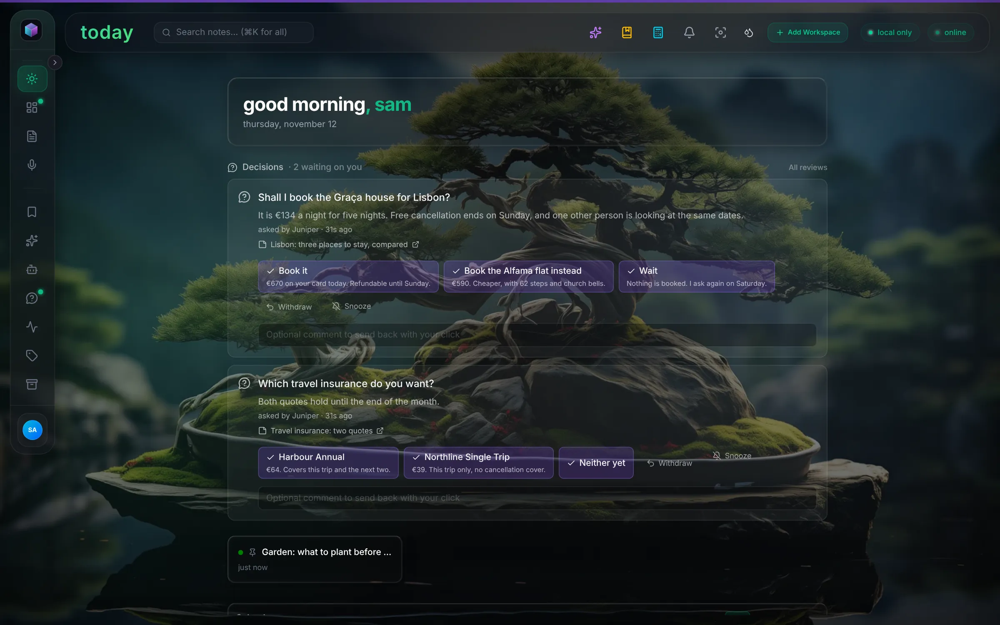
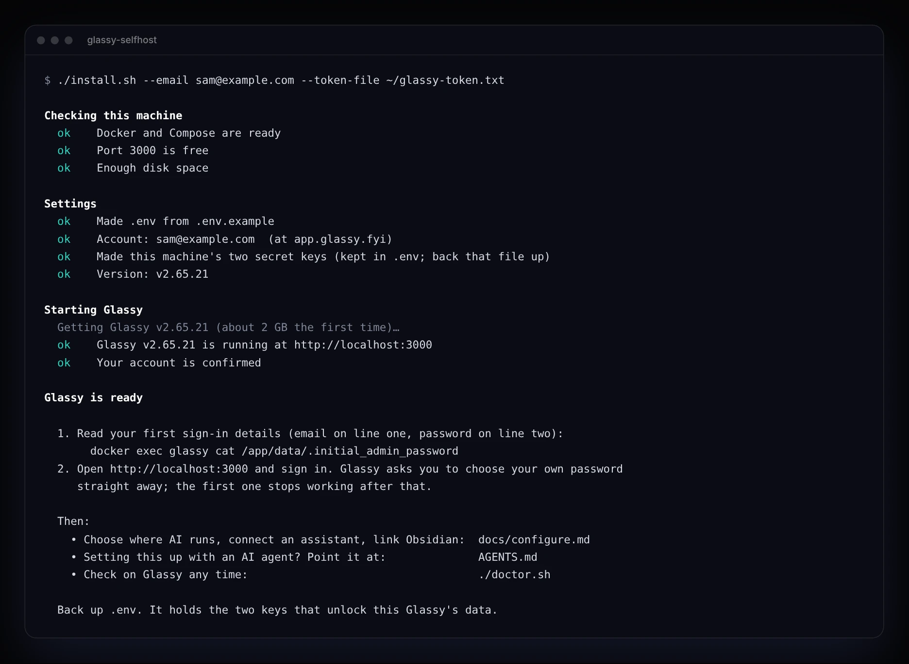
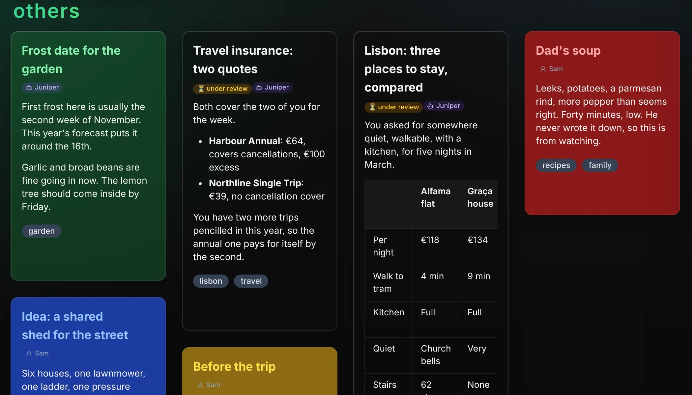
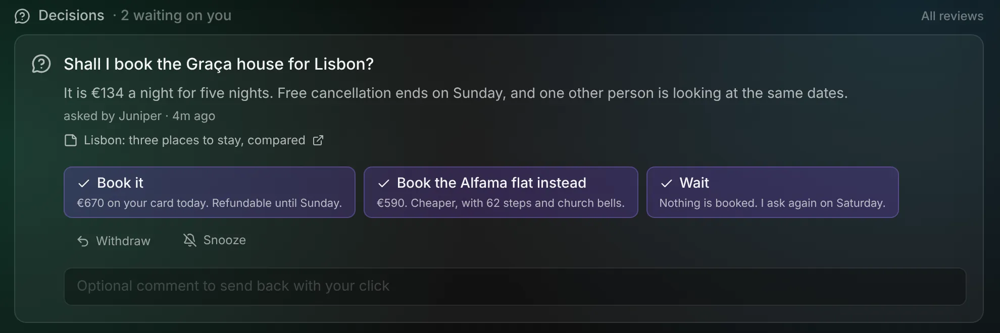
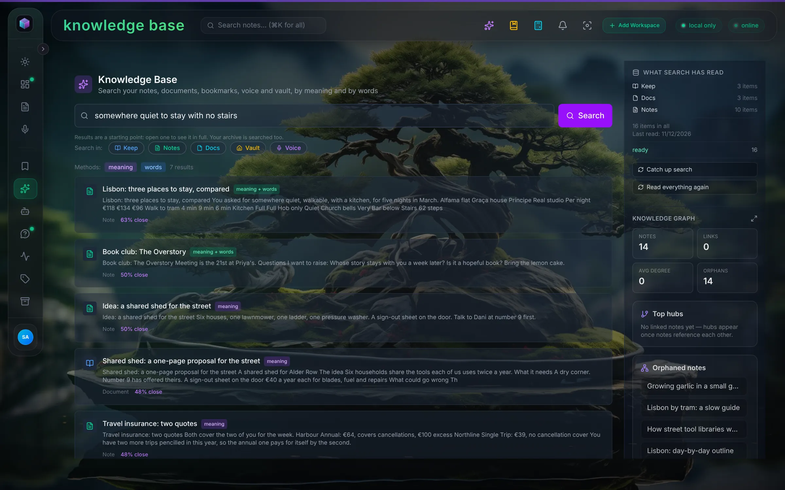
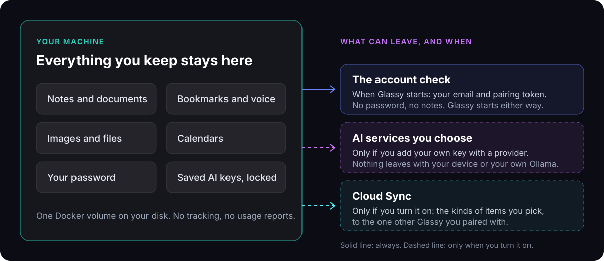
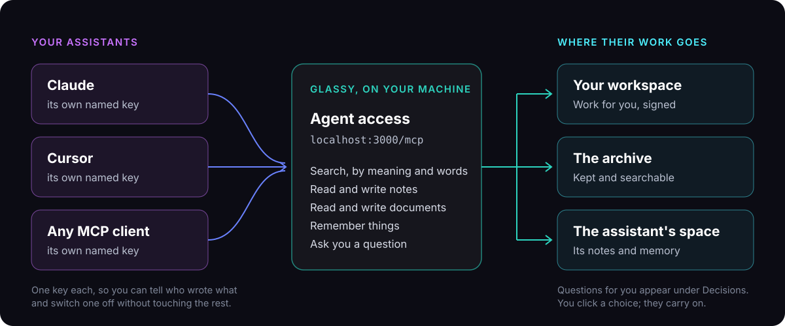

# Glassy Self-Host

[](https://github.com/0Reliance/glassy-selfhost/releases)
[](docs/install.md)
[](AGENTS.md)
[](LICENSE)



**The second brain for you and your agents, running on your own machine.**

Notes, documents, bookmarks, voice memos, calendars and boards on one calm page. It is the
same page your AI assistants read and write, each under its own name. Your files stay on your
disk.

This repository installs it. One container, about ten minutes.

[Install](#install) · [What you get](#what-you-get-here) · [What you take on](#what-you-take-on) · [For AI agents](#for-ai-agents) · [Guides](#guides)

## Install

You need [Docker](https://docs.docker.com/get-docker/) and a Glassy account. A free one is
enough: [sign up at glassy.fyi](https://glassy.fyi).

```bash
git clone https://github.com/0Reliance/glassy-selfhost.git
cd glassy-selfhost
./install.sh
```

On Windows, in PowerShell: `.\install.ps1`

The installer checks your machine, asks for your account email and pairing token, starts
Glassy, and tells you how to sign in at `http://localhost:3000`.



The full walk-through, including doing it by hand, is in [docs/install.md](docs/install.md).

## What you get here

This is all of Glassy, the same software that runs on glassy.fyi. Running it yourself is where
these three go furthest.

### Your assistants work beside you

Give each assistant its own named key. It reads what you've saved, writes where you can see it,
and asks you when a choice is yours. You can always tell who wrote what.





### AI runs where you choose

In your browser, on your own Ollama, or with your own key from a provider. Glassy provides no
AI here and never bills you for any. With none set up, everything except AI still works.

With a model of your own, search finds things by what you meant as well as the words you typed.



### Your Obsidian vault, live

Keep writing in Obsidian. Glassy searches your vault beside everything else you save, and an
edit in Glassy lands in the file. [How to link it](docs/obsidian.md).

## What you take on

- **You run the updates.** Nothing changes until you choose. [Update Glassy](docs/upgrade.md).
- **Backups are yours.** Glassy saves a copy every night on the same disk. Keeping one
  somewhere else is up to you. [Backups](docs/backups.md).
- **One person by default.** More workspaces for you are free. More people need a seat pack.
- **It lives in Docker**, using about 2 GB of disk plus your notes.

## What leaves your machine



When Glassy starts, it confirms your account with the Glassy cloud: your email and pairing
token, no password, no notes. If that can't happen, Glassy starts anyway. After that, the only
things that leave are the ones you turn on. There is no tracking. [Security and privacy](docs/security.md).

## For AI agents

Handing this to an assistant? Give it **[AGENTS.md](AGENTS.md)**. It routes an agent to one of
four sets of steps: install Glassy, set it up, work in it, or fix it. Each says what to ask
you first, when to stop, and how to show the job is done.



Connecting an assistant yourself takes a minute: [Agents in your Glassy](docs/agents.md).

## Guides

| I want to… | Read |
|---|---|
| Install Glassy | [docs/install.md](docs/install.md) |
| Choose where AI runs, connect an assistant, change settings | [docs/configure.md](docs/configure.md) |
| Understand AI and search here | [docs/ai.md](docs/ai.md) |
| Work with assistants | [docs/agents.md](docs/agents.md) |
| Link my Obsidian vault | [docs/obsidian.md](docs/obsidian.md) |
| Use Glassy on my phone or another computer | [docs/reach-it-from-other-devices.md](docs/reach-it-from-other-devices.md) |
| Keep a second copy in sync | [docs/cloud-sync.md](docs/cloud-sync.md) |
| Run two Glassys of my own, with no Glassy server between them | [PAIRING.md](PAIRING.md) |
| Back up and restore | [docs/backups.md](docs/backups.md) |
| Update, or see what changed | [docs/upgrade.md](docs/upgrade.md), [docs/whats-new.md](docs/whats-new.md) |
| Sort out my account or a forgotten password | [docs/accounts.md](docs/accounts.md) |
| Fix a problem | `./doctor.sh`, then [docs/troubleshooting.md](docs/troubleshooting.md) |
| Know what is private | [docs/security.md](docs/security.md) |

Learn Glassy itself, step by step, at [learn.glassy.fyi](https://learn.glassy.fyi). The full
product documentation is at [docs.glassy.fyi](https://docs.glassy.fyi).

## Help

Run `./doctor.sh` first. Then [open an issue](https://github.com/0Reliance/glassy-selfhost/issues/new/choose)
for a problem with installing or running Glassy yourself. Assistants file theirs with the
"Agent report" form.

The files in this repository are produced from Glassy's main source on every release, so
changes made here directly are replaced. [Contributing](.github/CONTRIBUTING.md) says how to
suggest one.

## License

The Docker Compose files, Caddy configuration, scripts and documentation in this repository
are licensed under the **MIT License**.

The Glassy application image (`ghcr.io/0reliance/glassy-dash`) pulled by these compose files is
separately licensed under the **Business Source License 1.1** (BSL 1.1). It is available for
personal, non-commercial, self-hosted use and will transition to **AGPL-3.0** on 2027-07-13.

For commercial licensing: hello@glassy.fyi
