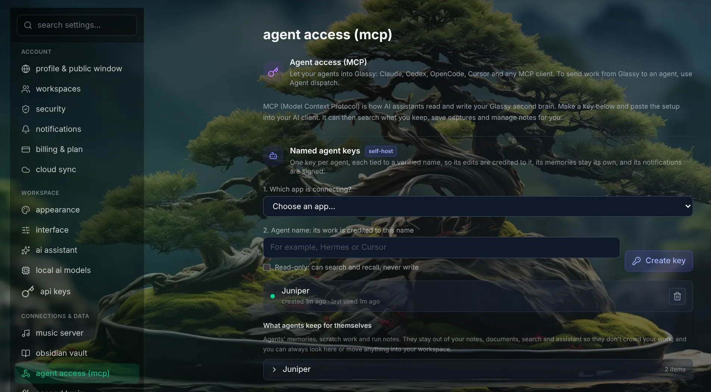
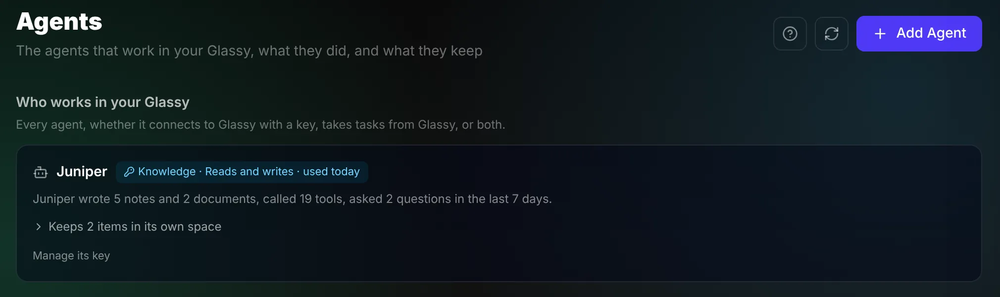

# Agents in your Glassy

Glassy is built for you and your AI assistants to share. They read what you've saved, write
their work where you can see it, and ask you when a choice is yours.

## Connect an assistant

1. Open **Settings → Connections & data → Agent access (MCP)**.
2. Under **Named agent keys**, choose which app is connecting and give the key the assistant's name.
3. Tick **Read-only** if it should search and recall but never write.
4. Choose **Create key**, then copy the setup the panel shows for that app into the assistant.

The address assistants connect to is `http://localhost:3000/mcp`.

Give your assistant [AGENTS.md](../AGENTS.md) too. It tells an agent how to work in Glassy well.

## See what your assistants did

The **Agents** page, in the sidebar, lists everyone who works in your Glassy: what each wrote,
how many tools it called, what it asked you, and what it keeps for itself.

## Why one key per assistant

- **You can tell who wrote what.** Each note and document shows whether you or an assistant
  wrote it, and which one. Search can show everyone's work, only yours, or only your assistants'.
- **You can switch one off.** Revoking a key stops that assistant and nothing else.
- **Each keeps its own memory.**

The panel also has one shared key. It works, but everything written with it is marked only as
"MCP agent". Use named keys.

## Where assistants' work goes

| Place | What's there | Where you see it |
|---|---|---|
| Your workspace | What an assistant wrote for you | With your own notes and documents. Documents land in the "Agent work" folder. |
| The archive | Finished work worth keeping | Found by search. Out of your everyday lists. |
| The assistant's own space | Its working notes and memory | On the Agents page and in Settings → Agent access (MCP), listed per assistant. Kept out of your lists and search, never hidden from you. |

You can move anything from one place to another.

## When an assistant asks you something

A question from an assistant appears under **Decisions** on Today, with the choices as buttons
and what each one leads to. Click one; the assistant picks up your answer and carries on.
Nothing consequential needs to happen without you.

## What an assistant can't do

- Sign in as you, or see your password.
- Restore something from the bin. Only you can.
- Change your settings, keys or account.

## Letting Glassy hand work to an agent

The other direction is called dispatch: Glassy starts a task on an agent you run, from a
calendar event or a button. Set it up in **Settings → Connections & data → Agent dispatch**.
The technical details are in the [agent reference](../agents/REFERENCE.md#connecting-an-agent-as-a-dispatch-target).

## Agents on Glassy's cloud

Glassy cloud accounts have agent access too, with one key per account and a limit on calls
per hour. Named keys, questions under Decisions and notices are part of running Glassy yourself.
