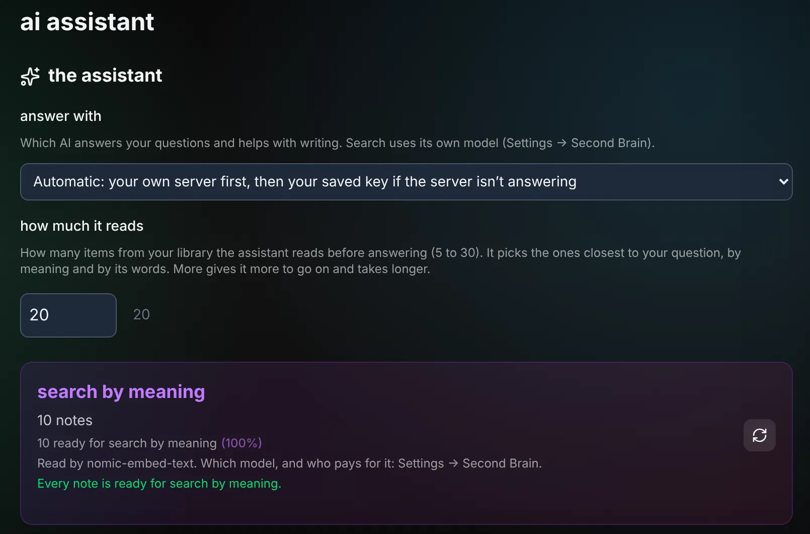

# AI on your Glassy

Glassy on your machine uses AI that you bring. Glassy provides none here and never bills you
for any. You choose where it runs, and you can mix.

| Where | What it costs you | Good for |
|---|---|---|
| **This device**: models in your browser | Nothing | Trying things with no setup. Works while Glassy is open in a tab. |
| **Your own server**: Ollama | Nothing | Everything, privately, including work that runs while you're away |
| **Your own key**: a provider you have an account with | That provider's bill | The strongest models |

## This device

Settings → Workspace → Local AI models. Pick a model; your browser downloads it once and runs
it on your device. Nothing leaves the machine.

On-device work only runs while Glassy is open in a tab on that device. With a large library,
search takes a few visits to catch up.

## Your own server (Ollama)

**Ollama is already on this machine.** Glassy finds it at its usual address. Pull a model for
answers and one for search:

```bash
ollama pull llama3.2
ollama pull nomic-embed-text
```

If you use a different model for answers, set `OLLAMA_MODEL` in `.env` to its exact name as
`ollama list` shows it.

**You don't have Ollama.** Start the one that comes with Glassy:

```bash
./install.sh --with-ollama
docker compose -f docker-compose.yml -f docker-compose.ollama.yml exec ollama ollama pull llama3.2
docker compose -f docker-compose.yml -f docker-compose.ollama.yml exec ollama ollama pull nomic-embed-text
```

Models are a few gigabytes each and live in their own Docker volume. Have an NVIDIA graphics
card? Install the NVIDIA Container Toolkit and uncomment the `deploy` block in
`docker-compose.ollama.yml`.

**Ollama is on another machine.** Set `OLLAMA_BASE_URL` in `.env` to its address, then
`docker compose up -d`.

## Your own key

Settings → Workspace → API keys. Add a key from a provider you have an account with. Glassy
stores it locked, on your machine, and uses it for answers, writing help and tags. The provider
bills you directly.

If you have both a key and Ollama, Glassy asks your own server first and uses your key when the
server isn't answering. Change that with "Answer with" in Settings → Workspace → AI assistant.

## Search by meaning

Search finds things by what you meant as well as by the words you typed. Searching by words
always works. Searching by meaning needs one model to read your library.

- By default that is `nomic-embed-text` on your own Ollama.
- You can choose an on-device model instead, in Settings → Workspace → Local AI models.
- Each workspace uses one search model at a time. Results from two different models can't be
  compared, so Glassy never mixes them.

**Settings → Connections & data → Second Brain** shows which model reads your library, whose
it is (your server, your key or your device), how much is ready, and what it needs if it paused.

Changing the search model means reading the library again with the new one. The Second Brain
panel has a rebuild button for that; it asks you to confirm, and search by words keeps working
while it catches up.

## Voice notes

If you saved a key that can transcribe, it does the transcribing. Otherwise the recorder
offers to download Whisper once (about 150 MB) and transcribe on your device. If neither is
there, Glassy keeps the recording and you can transcribe it later. The recorder says which way
it will use before you record.



## When there is no AI yet

Nothing breaks. Notes, documents, bookmarks, voice recording, calendars and search by words all
work. Glassy tells you what you could turn on, and where.

The full technical detail: [operations reference](reference/operations.md#6-ai-providers-byok--ollama).
